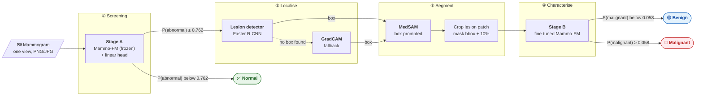
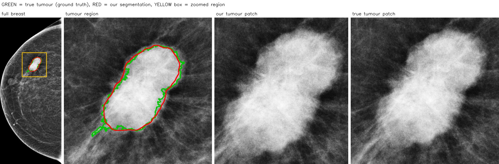
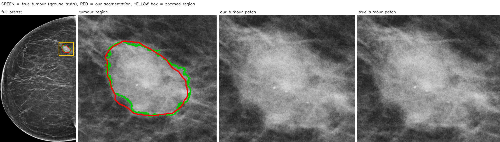
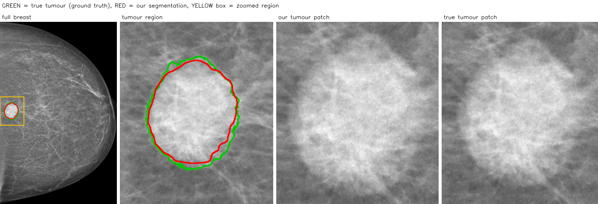
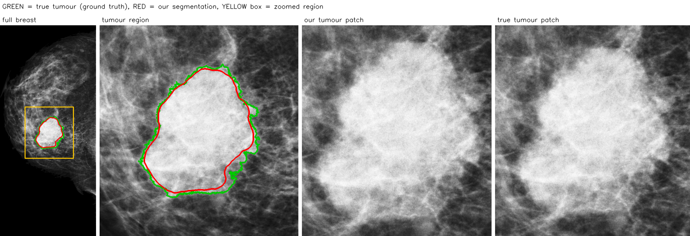

<div align="center">

# 🩺 Mammo Pipeline

**From one mammogram to a decision: normal / abnormal → lesion segmentation → benign / malignant**


[Pipeline](#-the-pipeline) •
[Install](#-installation) •
[Weights](#-weights) •
[Run](#-run-it) •
[Outputs](#-outputs) •
[Examples](#%EF%B8%8F-example-outputs) •
[Models](#-the-models) •
[Python API](#-python-api) •
[Notes](#-usage-notes)

</div>

> [!WARNING]
> **Research use only.** Not a medical device and not validated for clinical use. Do not use it for diagnosis
> or any clinical decision.

---

## 🔎 The pipeline



| Step | What happens | Model |
|:---:|---|---|
| ① | Is there anything suspicious in the image? If not, stop and report **normal**. | Mammo-FM + linear head |
| ② | Where is the lesion? A detector draws a box; if it finds nothing, a GradCAM heat map gives the box. | Faster R-CNN / GradCAM |
| ③ | Outline the lesion inside the box and cut out a patch around it. | MedSAM |
| ④ | Is the lesion **benign** or **malignant**? | fine-tuned Mammo-FM |

**Example result:** full breast → tumour region → our tumour patch → true tumour patch
(green = true tumour, red = our segmentation, yellow box = zoomed region). More in [Example outputs](#%EF%B8%8F-example-outputs).



---

## ⚙️ Installation

```bash
git clone https://github.com/MariamHassan20/mammo-pipeline.git
cd mammo-pipeline

conda env create -f environment.yml
conda activate mammo-cascade
```

<details>
<summary><b>Using pip instead of conda</b></summary>

```bash
# Python 3.10
pip install -r requirements.txt --extra-index-url https://download.pytorch.org/whl/cu121
# CPU only:
pip install -r requirements.txt --extra-index-url https://download.pytorch.org/whl/cpu
```
</details>

<details>
<summary><b>Tested versions and hardware</b></summary>

- Python 3.10, torch 2.3.0 + CUDA 12.1, transformers 4.37.2 (full list in `requirements.txt`)
- One GPU with **≥ 6 GB** memory recommended: all four models stay loaded.
- Models load once at start-up (about 1 minute); after that each image takes about a second on a recent GPU.
- CPU works too, just slower.
- If packages from `~/.local` interfere with the environment, run with `PYTHONNOUSERSITE=1`.
</details>

---

## 📦 Weights

Weights are **not** stored in the repository code. One command downloads all of them into `weights/`:

```bash
python scripts/download_weights.py
```

| Weight | Size | What it is | Source |
|---|---|---|---|
| `Mammo-FM_BatmanlabTrained_CLIP.tar` | 2.1 GB | original Mammo-FM foundation model (Stage A runs on it) | [batmanLab/Mammo-FM](https://huggingface.co/batmanLab/Mammo-FM) |
| MedSAM `wanglab/medsam-vit-base` | ~360 MB | original public MedSAM (kept in the Hugging Face cache) | [wanglab/medsam-vit-base](https://huggingface.co/wanglab/medsam-vit-base) |
| `mammo_fm_head.pt` | 63 KB | **ours:** Stage A head on top of Mammo-FM (normal / benign / malignant) | [release v1.0](https://github.com/MariamHassan20/mammo-pipeline/releases/download/v1.0/mammo_fm_head.pt) |
| `stage_b_finetuned.pt` | 110 MB | **ours:** Stage B, fully fine-tuned Mammo-FM (benign / malignant); self-contained | [release v1.0](https://github.com/MariamHassan20/mammo-pipeline/releases/download/v1.0/stage_b_finetuned.pt) |
| `lesion_detector.pt` | 159 MB | **ours:** Faster R-CNN lesion detector | [release v1.0](https://github.com/MariamHassan20/mammo-pipeline/releases/download/v1.0/lesion_detector.pt) |

The script checks our three files against their SHA-256 (listed in `weights/README.md`). If any weight is
missing when you run the pipeline, it stops at start-up and names the missing file.

<details>
<summary><b>Weights stored somewhere else?</b></summary>

Point to the folder or to single files with environment variables:

| Variable | Default |
|---|---|
| `CASCADE_WEIGHTS_DIR` | `weights/` |
| `MAMMOFM_CKPT` | `weights/Mammo-FM_BatmanlabTrained_CLIP.tar` |
| `CASCADE_STAGE_A_HEAD` | `weights/mammo_fm_head.pt` |
| `CASCADE_STAGE_B_CKPT` | `weights/stage_b_finetuned.pt` |
| `CASCADE_DETECTOR_CKPT` | `weights/lesion_detector.pt` |
| `CASCADE_MEDSAM_ID` | `wanglab/medsam-vit-base` |
| `CASCADE_MEDSAM_FINETUNED` | none (original MedSAM) |
</details>

---

## 🚀 Run it

```bash
# one image
python run_cascade.py --input path/to/view.png --out outputs/

# a whole folder (searched recursively for .png / .jpg / .tif)
python run_cascade.py --input path/to/folder/ --out outputs/ --device cuda:0

# with ground truth -> also writes metrics.xlsx and examples/
python run_cascade.py --input test_images/ --labels labels.csv --out outputs/test_run/
```

<details>
<summary><b>All options</b></summary>

| Flag | Default | Meaning |
|---|---|---|
| `--input` | required | image file, or folder (searched recursively) |
| `--out` | `outputs` | output folder (created if missing) |
| `--labels` | none | ground-truth CSV (`image,label[,mask]`) → adds `metrics.xlsx` and `examples/` |
| `--anonymize` | off | name outputs `case_0001`, `case_0002`, … instead of the file names; the case-ID ↔ image table is written **next to** the output folder as `<out>_case_map.csv` |
| `--device` | `cuda` if available | e.g. `cuda:0`, `cpu` |
| `--no-detector` | off | skip the detector; localise with GradCAM only |
| `--stage-b-input` | `patch` | `patch`, `whole` (whole image) or `both` (both scores reported; decision uses the patch) |
| `--pixel-spacing` | none | mm per pixel of the original image (DICOM `PixelSpacing`) → lesion size in mm |
| `--stage-a-threshold` | `0.762` | P(abnormal) threshold |
| `--stage-b-threshold` | from checkpoint (`0.058`) | P(malignant) threshold |
| `--medsam-finetuned` | none | path to a fine-tuned MedSAM state_dict (default: original MedSAM) |
</details>

<details>
<summary><b>Labels file format (<code>--labels</code>)</b></summary>

A CSV with:

| Column | Required | Content |
|---|---|---|
| `image` | yes | same path as given to `--input`, or just the file name |
| `label` | yes | `normal`, `benign`, `malignant` (or `0` / `1` for benign / malignant) |
| `mask` | no | path to the true tumour mask (white = tumour; 0/255 or 0/1) → enables Dice / IoU and the `examples/` figures |

```csv
image,label,mask
view_001.png,malignant,masks/view_001_mask.png
view_002.png,benign,masks/view_002_mask.png
view_003.png,normal,
```

With labels, Stage B is also scored for images that Stage A calls normal, so an AUC can be computed. These
images still get the decision "normal" and are shown as normal everywhere (overlay without box or outline, no
patch or mask, empty Stage B columns in `diagnosis.xlsx`); their extra scores are used only in `metrics.xlsx`.
</details>

---

## 📁 Outputs

```
outputs/
├── segmented_tumors/   <name>_patch.png    tumour crop (what Stage B classifies by default)
│                       <name>_mask.png     tumour mask (white = tumour)
├── overlays/           <name>_overlay.png  mammogram + box + tumour outline + scores + decision
├── json/               <name>.json         everything for one image
├── diagnosis.xlsx      one row per image: decision, probabilities, box, size, files, warnings
├── metrics.xlsx        (--labels) accuracy, AUC + 95% CI, F1, precision, sensitivity, specificity,
│                       confusion table, Stage A pass rates, segmentation Dice / IoU
└── examples/           (--labels with masks) 4 cases: true vs predicted outline, our patch, true patch
```

- **Overlay colours:** orange box = detector, magenta box = GradCAM, red = tumour outline; in `examples/`,
  green = true tumour.
- **Normal** images get a JSON, an overlay and a row in `diagnosis.xlsx` (no patch or mask).
- A bad image never stops a batch; its error is written to `diagnosis.xlsx`.

<details>
<summary><b>JSON format</b></summary>

```json
{
  "image": "view.png",
  "image_size_px": [W, H],
  "working_scale": 1.0,
  "stage_a": {"probs": {"normal": p, "benign": p, "malignant": p},
              "p_abnormal": p, "threshold": 0.762, "passed": true},
  "localisation": {"box_xyxy": [x0, y0, x1, y1], "source": "detector | gradcam", "score": s},
  "segmentation": {"area_px": n, "equiv_diameter_px": d, "medsam_weights": "wanglab/medsam-vit-base",
                   "area_mm2": "(only with --pixel-spacing)", "equiv_diameter_mm": "(only with --pixel-spacing)"},
  "patch": {"box_xyxy": [x0, y0, x1, y1], "from": "mask | box"},
  "stage_b": {"threshold": 0.058, "input": "patch", "p_malignant_patch": p, "decision": "benign | malignant"},
  "decision": "normal | benign | malignant",
  "warnings": [],
  "seconds": t
}
```
If Stage A says "normal", `localisation`, `segmentation`, `patch` and `stage_b` are absent (with `--labels`, the scores computed for
evaluation are kept separately under `evaluation_only`). Coordinates are in the *working* image:
the original, downscaled so its longer side is at most 4000 px (`working_scale` = the factor applied).
</details>

---

## 🖼️ Example outputs

The [`results/`](results/) folder shows sample outputs from a test run: four example figures and the
`diagnosis.xlsx` / `metrics.xlsx` files (anonymised cases).

| Example 1 | Example 2 |
|:---:|:---:|
|  |  |
| **Example 3** | **Example 4** |
|  |  |

Green = true tumour outline, red = our segmentation, yellow box = zoomed region. Each figure shows the full breast,
the tumour region, our tumour patch and
the true tumour patch.

---

## 🧠 The models

| Step | Model | Trained on | Preprocessing | Output |
|---|---|---|---|---|
| **Stage A** | Mammo-FM image encoder (EfficientNet-B5, frozen) + `Linear(2048, 3)`, temperature-calibrated | Mammo-Bench (public, 7 sources), patient-level split | CLAHE (2.0, 8×8) → 1520×912 → normalise → 3 ch | P(normal / benign / malignant) |
| **Detector** | Faster R-CNN ResNet50-FPN (COCO init), classes: background, lesion | multi-centre mass dataset, patient-level split | long side 800 → CLAHE → /255 → 3 ch | lesion box |
| **Segment** | MedSAM `wanglab/medsam-vit-base` (original weights) | MedSAM's public training data | RGB, longest side 1024, box prompt | binary mask (largest component) |
| **Stage B** | Mammo-FM EfficientNet-B5, fully fine-tuned + `Linear(2048, 2)` | benign / malignant mammograms | CLAHE → 760×456 → normalise → 3 ch | P(malignant) |

<details>
<summary><b>How the thresholds were chosen</b></summary>

Both were chosen on validation data during development:
- **Stage A, 0.762:** maximises balanced accuracy for normal vs abnormal.
- **Stage B, 0.058:** maximises malignant F2, so it favours sensitivity. Stored in the Stage B checkpoint.

Re-tune both for your own site with `--stage-a-threshold` and `--stage-b-threshold`.
</details>

---

## 🐍 Python API

```python
from mammo_cascade import Cascade
from mammo_cascade.visualize import save_outputs

casc = Cascade(device="cuda")                    # loads all models once
result, art = casc.run("view.png", pixel_spacing_mm=0.07, stage_b_input="patch")
print(result["decision"])                        # "normal" | "benign" | "malignant"
save_outputs(result, art, "outputs/view")        # writes overlay, patch and mask PNGs
```

<details>
<summary><b>Share a dataset as features instead of images</b></summary>

`scripts/extract_features.py` computes the frozen Mammo-FM feature vector (2048 numbers) of every image, so a
dataset can be analysed elsewhere without moving the images. Features cannot be turned back into images, and
the file is small (about 4 KB per image). It runs on a 10 GB GPU or on CPU.
```bash
python scripts/extract_features.py --input path/to/images/ --out features.npz --anonymize
python scripts/extract_features.py --csv labels.csv --out features.npz      # columns: image[,label][,source]
```
</details>

<details>
<summary><b>Large evaluations (resumable CSV output)</b></summary>

`scripts/evaluate_bm.py` runs the full chain on a labelled CSV (`image`, `label` = benign/malignant, optional
`mask`, `patient`, `group`) and writes `per_image.csv` (resumable) and `metrics.json`: patch and whole-image AUC
with patient-bootstrap CIs, sensitivity / specificity, Stage A pass rates, box sources, Dice, per-group AUCs.

```bash
python scripts/evaluate_bm.py --csv labelled.csv --out eval_out/ --device cuda:0
```
</details>

---

## 📝 Usage notes

1. **Stage B was trained on whole images.** By default it classifies the lesion patch; use
   `--stage-b-input both` to see the patch and whole-image scores side by side.
2. **Thresholds are not universal.** Re-tune them on validation data from your own site.
3. **The detector was trained on masses.** Calcifications and architectural distortions are not targeted.
4. **GradCAM** is used only when the detector finds no box; a warning is then written to the JSON.
5. **Input** is a PNG/JPG/TIFF of one view. No DICOM reading, no laterality/view handling, no CC/MLO fusion.
   16-bit images (e.g. 12-bit mammograms) are scaled to 8-bit; images longer than 4000 px are downscaled first.
   Images smaller than 256 px or blank images are rejected with an error in `diagnosis.xlsx`.
6. **Lesion size in mm** needs `--pixel-spacing`; the working-scale correction is applied automatically.

---

## 📜 Licences and credits

- **This code:** LICENCE_TO_ADD
- `mammo_cascade/mfm/` (`efficientnet_custom.py`, `efficient_net_custom_utils.py`, `projection.py`): from the
  [Mammo-FM](https://huggingface.co/batmanLab/Mammo-FM) repository (batmanLab, Apache-2.0).
- **Mammo-FM weights:** batmanLab academic licence (non-commercial research only). `mammo_fm_head.pt` and
  `stage_b_finetuned.pt` are built on Mammo-FM, so its terms apply to them too.
- **MedSAM** ([wanglab/medsam-vit-base](https://huggingface.co/wanglab/medsam-vit-base)): Apache-2.0.
- **torchvision** Faster R-CNN: BSD-3-Clause.

If you use this pipeline, please also cite Mammo-FM and MedSAM.
